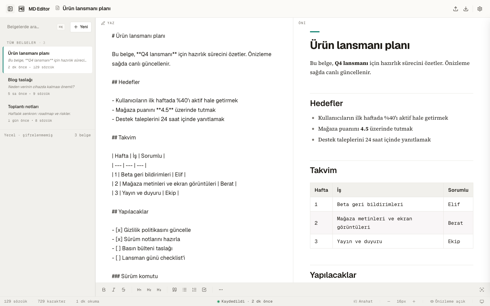
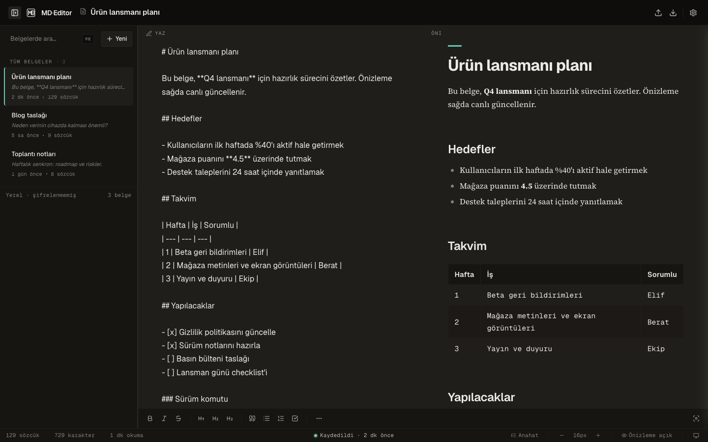
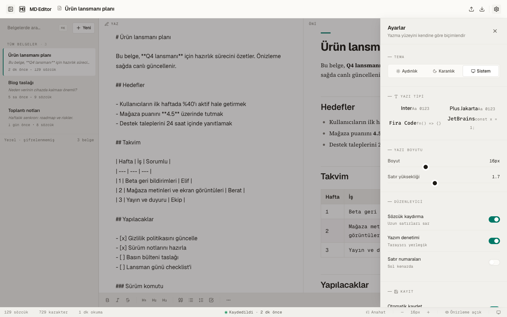
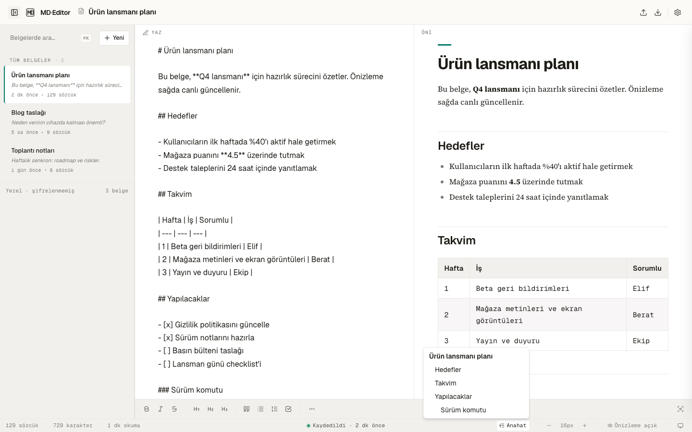
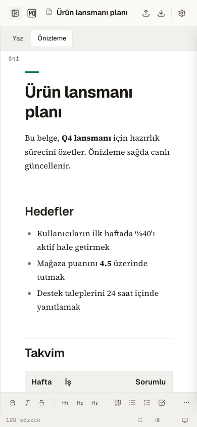

# MD Editor

A local-first Markdown workspace built with Next.js 16, React 19, TypeScript, and Tailwind CSS 4.



## Highlights

- Distraction-light split writing and live preview workspace
- Searchable document library with create, rename, duplicate, delete (with undo), import, and export
- Outline of the document's headings in the status bar; picking one moves the editor and preview there
- Selection-aware Markdown toolbar and keyboard-friendly native editor
- Local persistence under the existing `md-editor-documents`, `md-editor-settings`, and `md-editor-theme` keys
- Light, dark, and system themes plus typography, wrapping, spellcheck, and preview controls
- Responsive document drawer and Yaz / Önizleme tabs on phones (one pane at a time)
- GFM tables/tasks and syntax highlighting; raw HTML is intentionally not rendered
- Import local `.md` files into the library and export the active document back to disk as Markdown

## Tech Stack

**Framework & language**
- [Next.js](https://nextjs.org/) `16.2.7` (App Router, client-rendered workspace)
- [React](https://react.dev/) `19.2.4` + `react-dom` `19.2.4`
- [TypeScript](https://www.typescriptlang.org/) `^5`

**Styling**
- [Tailwind CSS](https://tailwindcss.com/) `^4` via `@tailwindcss/postcss`
- [`tw-animate-css`](https://github.com/Wombosvideo/tw-animate-css) for animation utilities
- [`clsx`](https://github.com/lukeed/clsx) + [`tailwind-merge`](https://github.com/dcastil/tailwind-merge) + [`class-variance-authority`](https://cva.style.dev/) for class composition

**UI primitives & icons**
- [`@base-ui/react`](https://base-ui.com/) `^1.5` powering the [`shadcn`](https://ui.shadcn.com/) component layer (`src/components/ui/*`)
- [`lucide-react`](https://lucide.dev/) and [`iconsax-reactjs`](https://iconsax.com/) for iconography

**Markdown rendering**
- [`react-markdown`](https://github.com/remarkjs/react-markdown) `^10` as the renderer
- [`remark-gfm`](https://github.com/remarkjs/remark-gfm) for tables, task lists, and GitHub-flavoured extensions
- [`rehype-highlight`](https://github.com/rehypejs/rehype-highlight) for syntax highlighting
- [`rehype-raw`](https://github.com/rehypejs/rehype-raw) is available but raw HTML is intentionally not rendered

**State, storage, and platform APIs**
- React state for the editor
- `localStorage` hook (`src/hooks/use-local-storage.ts`) under the `md-editor-documents`, `md-editor-settings`, and `md-editor-theme` keys
- Browser File API + `Blob`/`URL.createObjectURL` for `.md` import and export
- `window.matchMedia` for responsive drawer behaviour and the system theme

**Testing & quality**
- [Vitest](https://vitest.dev/) `^4` with [`@testing-library/react`](https://testing-library.com/), [`@testing-library/user-event`](https://testing-library.com/), [`@testing-library/jest-dom`](https://github.com/testing-library/jest-dom), and `jsdom`
- [ESLint](https://eslint.org/) `^9` with `eslint-config-next`

## Development

```bash
npm install
npm run dev
```

Open [http://localhost:3000](http://localhost:3000).

## Verification

```bash
npm test           # unit tests (Vitest)
npm run test:e2e   # Playwright end-to-end tests; builds and serves the app on port 3200, uses installed Chrome
npm run lint
npm run build
```

The end-to-end suite covers documents (create, rename, duplicate, delete and undo, search, import, export, persistence), the formatting toolbar and keyboard shortcuts, preview rendering (GFM, code highlighting, raw HTML stays inert), the outline, every settings control, the status bar, and the phone layout.

## Screenshots

| | |
|---|---|
|  |  |
|  |  |

Documents never leave your browser unless you explicitly export them.
